<!-- generated by scripts/render_readme_cards.py — edit config.json, not this file -->

<picture><source media="(prefers-color-scheme: dark)" srcset="./cards/dark/hero.svg"></picture>

<picture><source media="(prefers-color-scheme: dark)" srcset="./cards/dark/graph.svg"></picture>

<picture><source media="(prefers-color-scheme: dark)" srcset="./cards/dark/activity.svg"></picture>

<a href="https://github.com/TimurKry?tab=repositories"><picture><source media="(prefers-color-scheme: dark)" srcset="./cards/dark/tile-build.svg"></picture></a>
<a href="mailto:timur.dev@gmail.com"><picture><source media="(prefers-color-scheme: dark)" srcset="./cards/dark/tile-automate.svg"></picture></a>
<a href="https://github.com/TimurKry/cv"><picture><source media="(prefers-color-scheme: dark)" srcset="./cards/dark/tile-cv.svg"></picture></a>

<a href="https://github.com/TimurKry/AxlePress"><picture><source media="(prefers-color-scheme: dark)" srcset="./cards/dark/repo-AxlePress.svg"></picture></a>
<a href="https://github.com/TimurKry/memora-platform"><picture><source media="(prefers-color-scheme: dark)" srcset="./cards/dark/repo-memora-platform.svg"></picture></a>
 
<a href="https://github.com/TimurKry/meeting-point-finder"><picture><source media="(prefers-color-scheme: dark)" srcset="./cards/dark/repo-meeting-point-finder.svg"></picture></a>
<a href="https://github.com/TimurKry/mementos-landing"><picture><source media="(prefers-color-scheme: dark)" srcset="./cards/dark/repo-mementos-landing.svg"></picture></a>

